# STRUNA — Real-Time C++ DSP Guitar Tuner (React Native CLI + JSI)

**STRUNA** is a low-latency (< 50 ms), real-time chromatic and poly-preset guitar tuner built from scratch without any third-party pitch detection libraries (`pitchfinder`, `aubio`, etc.). All digital signal processing runs in native **C++17** and communicates synchronously with **React Native** via **JSI (`HostObject`)** and **Reanimated Worklets**.

---

## 1. Why Naive FFT Fails for Guitar Tuning

A common misconception is that a guitar tuner can simply run a Fast Fourier Transform (FFT) and pick the bin with the highest magnitude. In practice, **naive FFT fails on real guitar strings for three mathematical reasons**:

1. **Frequency Resolution Bottleneck on Low Strings ($E_2 = 82.41\text{ Hz}$):**
   The frequency spacing between adjacent FFT bins is:
   $$\Delta f = \frac{f_s}{N}$$
   At $f_s = 48000\text{ Hz}$ with a $N = 2048$ window ($42.6\text{ ms}$), the bin resolution is:
   $$\Delta f = \frac{48000}{2048} = 23.4375\text{ Hz}$$
   However, 1 cent at $E_2$ ($82.41\text{ Hz}$) is:
   $$82.41 \times \left(2^{1/1200} - 1\right) \approx 0.0476\text{ Hz}$$
   To distinguish $82.41\text{ Hz}$ from $83.00\text{ Hz}$ ($+12.3\text{ cents}$) directly via FFT bins, the window would need to be several seconds long—longer than a plucked guitar string sustains at stable pitch.

2. **Dominant Upper Harmonics (The Missing/Weak Fundamental Problem):**
   When a wound low $E_2$ ($82.41\text{ Hz}$) or $A_2$ ($110.00\text{ Hz}$) string is plucked and captured by a smartphone microphone, the 2nd harmonic ($2f_0 = 164.82\text{ Hz}$) and 3rd harmonic ($3f_0 = 247.23\text{ Hz}$) frequently have $3\times$ to $5\times$ higher amplitude than the fundamental $f_0$. Picking the loudest spectral peak causes an immediate **octave error** ($E_3$ instead of $E_2$).

---

## 2. Algorithm Benchmark: FFT vs. Autocorrelation vs. YIN

We benchmarked all three algorithms on identical synthetic signals at $f_s = 48000\text{ Hz}$, $N = 2048$ samples (verified by `cpp/tests/YinDetectorTests.cpp`):

### Test Case A: Pure Sine Wave ($E_2 = 82.41\text{ Hz}$)
| Algorithm | Measured Frequency | Error (Cents) | Pass ($\pm 1\text{ cent}$) |
| :--- | :---: | :---: | :---: |
| **Naive FFT Peak ($N = 2048$)** | $93.75\text{ Hz}$ | $+223.1\text{ cents}$ | No |
| **Standard Autocorrelation** | $82.41\text{ Hz}$ | $-0.02\text{ cents}$ | Yes |
| **YIN + Parabolic Interpolation** | $82.41\text{ Hz}$ | $< 0.01\text{ cents}$ | Yes |

### Test Case B: Realistic Guitar Tone ($f_0 = 82.41\text{ Hz}, A_1 = 0.25, A_2 = 1.00, A_3 = 0.75$)
| Algorithm | Measured Frequency | Detected Note | Octave Error? |
| :--- | :---: | :---: | :---: |
| **Naive FFT Peak** | $164.06\text{ Hz}$ | $E_3$ | **FAIL (Octave High)** |
| **Biased Autocorrelation** | $164.82\text{ Hz}$ | $E_3$ | **FAIL (Octave High)** |
| **STRUNA YIN Engine** | **$82.41\text{ Hz}$** | **$E_2$** | **PASS ($0.00\text{ cents}$ error)** |

### Visual Comparison of Correlation / Difference Curves ($f_0 = 82.41\text{ Hz}, T_0 = 582.45\text{ samples}$)

```text
Biased Autocorrelation R(tau) on Dominant 2nd Harmonic:
 +1.0 |           * (False Global Peak at T0/2 = 291.2 samples -> 164.82 Hz!)
 +0.8 |          * *                       * (True Period T0 = 582.5 tapered down by N - tau)
 +0.4 |         *   *                     * *
  0.0 +--------*-----*-------------------*---*-----------------> tau (samples)
               0    291                 582

YIN Cumulative Mean Normalized Difference d'(tau) on Same Signal:
  1.0 | *
  0.6 |  *                 *   *
  0.2 |   *               *     *
  0.1 |----*-------------*-------*-------[Threshold = 0.12]----
  0.0 +-----*-----------*---------*------*---------------------> tau (samples)
                        291             582 (Global CMNDF Minimum d'(T0) = 0.0001 -> 82.41 Hz!)
```

---

## 3. End-to-End Real-Time Latency Budget ($< 50\text{ ms}$)

```mermaid
flowchart LR
    Mic["Hardware Mic (48 kHz)"] -->|"10.6 ms (512 frames)"| RB["Lock-Free SPSC RingBuffer"]
    RB -->|"1.1 ms (2048 sliding window)"| YIN["C++17 YIN + Parabolic Interp"]
    YIN -->|"0.1 ms"| Stab["PitchStabilizer (Median 5 + Attack Gate)"]
    Stab -->|"0.02 ms (Synchronous JSI)"| SV["Reanimated SharedValue"]
    SV -->|"16.6 ms (60 FPS Worklet)"| UI["SVG GaugeNeedle"]
```



- **Audio Hop Size:** $512\text{ samples}$ at $48000\text{ Hz} = 10.67\text{ ms}$
- **C++17 YIN Execution Time:** $\approx 1.1\text{ ms}$ on ARM64 (`-O3 -ffast-math`), zero heap allocations
- **JSI Synchronous Poll (`__StrunaEngine.pollPitchFrame`):** $< 0.05\text{ ms}$, zero JSON serialization
- **UI Worklet Frame:** $16.67\text{ ms}$
- **Total Pluck-to-Needle Latency:** **$\approx 28.5\text{ ms}$** (well below the $50\text{ ms}$ target)

---

## 4. Running C++ Tests & Acoustic Verification

### 1. Run Standalone C++17 DSP Unit Tests (No Emulator Required)
```bash
cmake -S cpp/tests -B build/tests
cmake --build build/tests
ctest --test-dir build/tests --output-on-failure
```

### 2. Run TypeScript Strict & FSD Linter Checks
```bash
npm run typecheck
npm run lint
```

### 3. Acoustic Verification with Web Audio Tone Generator
Open `tools/tone-generator.html` in any desktop browser to synthesize pure sine waves or harmonic-rich guitar tones with $\pm 0.5\text{ cent}$ detune sliders.
