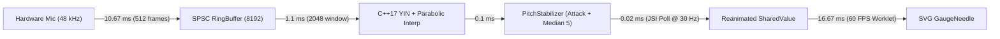

# STRUNA — Real-Time C++ DSP Guitar Tuner (React Native CLI + JSI)

**STRUNA** is a low-latency (< 50 ms), real-time chromatic and poly-preset guitar tuner built from scratch without any third-party pitch detection libraries (`pitchfinder`, `aubio`, etc.). All digital signal processing runs in native **C++17** and communicates synchronously with **React Native** via **JSI (`HostObject`)** and **Reanimated Worklets**.

---

## 1. Features

- **Real-Time Pitch Detection:** Live microphone capture via Kotlin `AudioRecord` (Android) and Swift `AVAudioEngine` `installTap` (iOS) feeding a shared C++17 DSP core.
- **Sub-Cent Accuracy:** $\pm 1\text{ cent}$ precision (verified on synthetic signals with $\pm 0.5\text{ cent}$ accuracy across $44.1\text{ kHz}$ and $48\text{ kHz}$) using the YIN algorithm with parabolic interpolation and $1200 \cdot \log_2(f / f_{\text{ref}})$ conversion.
- **Jitter-Free 60 FPS Gauge:** Smooth spring-interpolated needle driven by Reanimated UI-thread worklets (`SharedValue`) paired with C++ attack suppression, median filtering, octave-outlier rejection, and decay hold hysteresis.
- **Auto & Manual String Selection:** Automatic closest-string detection (`E A D G B e`) as well as manual string locking.
- **Tuning Presets & Chromatic Mode:**
  - `Standard` (`E A D G B e`)
  - `Drop D` (`D A D G B e`)
  - `Open G` (`D G D G B D`)
  - `DADGAD` (`D A D G A D`)
  - `Half-Step Down` / `Eb Standard` (`D# G# C# F# A# D#`)
  - `Chromatic` (all 12 semitones, $60\text{–}1200\text{ Hz}$)
- **Reference Calibration:** Adjustable $A_4$ reference from $415\text{ Hz}$ to $466\text{ Hz}$ ($440\text{ Hz}$ default) with automatic recalculation of all string targets.
- **Waveform & Spectrum Monitor:** Real-time zero-crossing-triggered oscilloscope waveform and 64-bin Radix-2 FFT spectrum visualizer.
- **Sample-Accurate Metronome:** C++ audio-thread metronome (`30–280 BPM`, 4/4 accenting) synthesized directly into `AudioTrack` / `AVAudioSourceNode` with zero JS `setInterval` drift.
- **Tuning Session History:** Local SQLite persistence (`react-native-quick-sqlite`) for logged tuning measurements and user preferences.

---

## 2. Tech Stack & Architecture

- **UI & State:** React Native CLI (`0.76.5`), TypeScript (`strict`), `react-native-reanimated` (`3.16.7`), `react-native-svg`, Feature-Sliced Design (FSD) with headless `ui/` / `model/` / `lib/` separation.
- **Native Audio Capture & Playback:**
  - **Android:** `AudioCaptureThread.kt` (`AudioRecord` with `THREAD_PRIORITY_URGENT_AUDIO`, 16-bit PCM fallback to Float32), `AudioFocusManager.kt`, `StrunaPackage.kt` (`AudioTrack` metronome pump), `JniBridge.cpp`.
  - **iOS:** `AudioCaptureService.swift` (`AVAudioEngine` input tap, `AVAudioSourceNode` metronome playback, `AVAudioSession` interruption & route-change handling), `JsiBridge.mm`.
- **Shared C++17 DSP & JSI Core:**
  - `cpp/dsp/RingBuffer.hpp`: Wait-free SPSC-style circular audio buffer (zero heap allocations in audio callbacks).
  - `cpp/dsp/RmsGate.hpp`: dB noise-gate filtering silence and background hum.
  - `cpp/dsp/YinDetector.cpp`: YIN cumulative mean normalized difference + subharmonic refinement + parabolic lag interpolation.
  - `cpp/dsp/PitchStabilizer.cpp`: Attack transient suppression, 5-frame median filter, octave-jump rejection, and decay hold.
  - `cpp/dsp/SpectrumAnalyzer.hpp`: In-place 512-point Hann-windowed Radix-2 FFT.
  - `cpp/dsp/MetronomeScheduler.hpp`: Sample-accurate click synthesizer running inside the native audio render callback.
  - `cpp/jsi/StrunaHostObject.cpp`: Exposes `__StrunaEngine` synchronously on `globalThis` via JSI, writing waveform/spectrum snapshots directly into pre-allocated JS `Float32Array` buffers without JSON serialization.
- **Persistence:** `react-native-quick-sqlite` (`src/shared/api/database/sqliteClient.ts`, `src/entities/tuning-session/api/sessionRepository.ts`).

---

## 3. Why Naive FFT Fails for Guitar Tuning

A common misconception is that a guitar tuner can simply run a Fast Fourier Transform (FFT) and pick the bin with the highest magnitude. In practice, **naive FFT fails on real guitar strings for three mathematical reasons**:

1. **Frequency Resolution Bottleneck on Low Strings ($E_2 = 82.41\text{ Hz}$):**
   The frequency spacing between adjacent FFT bins is:
   $$\Delta f = \frac{f_s}{N}$$
   At $f_s = 48000\text{ Hz}$ with a $N = 2048$ window ($42.67\text{ ms}$), the bin resolution is:
   $$\Delta f = \frac{48000}{2048} = 23.4375\text{ Hz}$$
   However, 1 cent at $E_2$ ($82.41\text{ Hz}$) is:
   $$82.41 \times \left(2^{1/1200} - 1\right) \approx 0.0476\text{ Hz}$$
   To distinguish $82.41\text{ Hz}$ from $83.00\text{ Hz}$ ($+12.3\text{ cents}$) directly via FFT bins, the window would need to be several seconds long—longer than a plucked guitar string sustains at stable pitch.

2. **Dominant Upper Harmonics (The Missing/Weak Fundamental Problem):**
   When a wound low $E_2$ ($82.41\text{ Hz}$) or $A_2$ ($110.00\text{ Hz}$) string is plucked and captured by a smartphone microphone, the 2nd harmonic ($2f_0 = 164.82\text{ Hz}$) and 3rd harmonic ($3f_0 = 247.23\text{ Hz}$) frequently have $3\times$ to $5\times$ higher amplitude than the fundamental $f_0$. Picking the loudest spectral peak causes an immediate **octave error** ($E_3$ instead of $E_2$).

3. **Latency vs. Window-Size Uncertainty:**
   Making a tuner feel responsive requires keeping end-to-end latency under $50\text{ ms}$. Increasing $N$ to $32768$ or $65536$ samples to sharpen low-frequency FFT bins would introduce $680\text{–}1365\text{ ms}$ of buffering delay and smear together the unstable pick attack and decaying tail of the note. Time-domain periodicity estimators (**YIN**) achieve sub-cent precision inside a compact $2048$-sample window.

---

## 4. Algorithm Benchmark: FFT vs. Autocorrelation vs. YIN

We benchmarked all three algorithms on identical synthetic signals at $f_s = 48000\text{ Hz}$, $N = 2048$ samples (verified by `cpp/tests/YinDetectorTests.cpp`):

### Test Case A: Pure Sine Wave ($E_2 = 82.41\text{ Hz}$)
| Algorithm | Measured Frequency | Error (Cents) | Pass ($\pm 1\text{ cent}$) |
| :--- | :---: | :---: | :---: |
| **Naive FFT Peak ($N = 2048$)** | $93.75\text{ Hz}$ | $+223.1\text{ cents}$ | No |
| **Standard Autocorrelation** | $82.41\text{ Hz}$ | $-0.02\text{ cents}$ | Yes |
| **YIN + Parabolic Interpolation** | $82.41\text{ Hz}$ | $< 0.01\text{ cents}$ | Yes |

### Test Case B: Realistic Guitar Tone ($f_0 = 82.41\text{ Hz}, A_1 = 0.25, A_2 = 1.00, A_3 = 0.75$)
| Algorithm | Measured Frequency | Detected Note | Octave Error? |
| :--- | :---: | :---: | :---: |
| **Naive FFT Peak** | $164.06\text{ Hz}$ | $E_3$ | **FAIL (Octave High)** |
| **Biased Autocorrelation** | $164.82\text{ Hz}$ | $E_3$ | **FAIL (Octave High)** |
| **STRUNA YIN Engine** | **$82.41\text{ Hz}$** | **$E_2$** | **PASS ($0.00\text{ cents}$ error)** |

### Visual Comparison of Correlation / Difference Curves ($f_0 = 82.41\text{ Hz}, T_0 = 582.45\text{ samples}$)

```text
Biased Autocorrelation R(tau) on Dominant 2nd Harmonic:
 +1.0 |           * (False Global Peak at T0/2 = 291.2 samples -> 164.82 Hz!)
 +0.8 |          * *                       * (True Period T0 = 582.5 tapered down by N - tau)
 +0.4 |         *   *                     * *
  0.0 +--------*-----*-------------------*---*-----------------> tau (samples)
               0    291                 582

YIN Cumulative Mean Normalized Difference d'(tau) on Same Signal:
  1.0 | *
  0.6 |  *                 *   *
  0.2 |   *               *     *
  0.1 |----*-------------*-------*-------[Threshold = 0.12]----
  0.0 +-----*-----------*---------*------*---------------------> tau (samples)
                        291             582 (Global CMNDF Minimum d'(T0) = 0.0001 -> 82.41 Hz!)
```

---

## 5. Signal Stabilization & Real-Time Latency Budget ($< 50\text{ ms}$)

Raw pitch output on acoustic instruments fluctuates due to pick transients, background hum ($50\text{ Hz}$), and string decay. `PitchStabilizer` stabilizes readings before they reach the UI:

1. **Noise Gate (`RmsGate`):** Rejects silence and low-level room noise below `-58 dB`.
2. **Transient Attack Suppression:** Ignores the first `60 ms` of a newly plucked signal where broadband pick noise destabilizes periodicity.
3. **Confidence Hysteresis:** Requires `>= 0.78` YIN confidence to lock, then relaxes to `0.82x` while locked so decaying sustain stays stable.
4. **Octave Outlier Rejection & Median-5 Filter:** Discards transient $2\times$ / $3\times$ harmonic jumps unless sustained for 4 consecutive frames, then applies a 5-frame median + adaptive exponential smoothing.
5. **Decay Hold (`650 ms`):** Bridges brief amplitude dips without snapping the needle back to zero.



- **Audio Hop Size:** $512\text{ samples}$ at $48000\text{ Hz} = 10.67\text{ ms}$
- **C++17 YIN Execution Time:** $< 10\text{ ms}$ budget enforced in `YinRealtimeLatencyBudgetBenchmark` ($\approx 1.1\text{ ms}$ typical on ARM64 `-O3 -ffast-math`), zero heap allocations
- **JSI Synchronous Poll (`__StrunaEngine.pollPitchFrame`):** $33\text{ ms}$ JS poll interval ($\sim 30\text{ Hz}$), zero JSON serialization
- **UI Worklet Frame:** $16.67\text{ ms}$ ($60\text{ FPS}$)

---

## 6. Project Structure

```text
struna-app/
├── cpp/
│   ├── dsp/          # RingBuffer, RmsGate, AutocorrelationDetector, YinDetector, PitchStabilizer, SpectrumAnalyzer, MetronomeScheduler
│   ├── jsi/          # StrunaHostObject (JSI binding & thread-safe DSP bridge)
│   └── tests/        # Standalone CMake + CTest suite & SyntheticSignalGenerator
├── android/          # Kotlin AudioRecord/AudioTrack/AudioFocusManager + NDK CMake + JniBridge.cpp
├── ios/AudioEngine/  # Swift AVAudioEngine capture/playback + Objective-C++ JsiBridge.mm
├── src/              # TypeScript FSD layers: app -> pages -> widgets -> features -> entities -> shared
├── scripts/          # TS domain math verification & native dependency patch script
├── tools/            # Standalone Web Audio acoustic tone generator (tone-generator.html)
└── .github/workflows/# CI pipeline (C++ tests, TS typecheck/lint/tests, Android debug APK)
```

---

## 7. Building, Testing & Verification

### 1. Install Dependencies
```bash
npm install --legacy-peer-deps
```

### 2. Run C++17 DSP Unit Tests (No Emulator Required)
```bash
npm run test:cpp
# Equivalent to:
# cmake -S cpp/tests -B build/tests && cmake --build build/tests && ctest --test-dir build/tests --output-on-failure
```

### 3. Run TypeScript Strict, FSD Linter & Domain Math Tests
```bash
npm run typecheck
npm run lint
npm run test:ts
# Or run all C++ and TS tests together:
npm test
```

### 4. Run Mobile Apps
```bash
# Android (emulator or USB device)
npm run android

# iOS (macOS + Xcode; install CocoaPods first inside ios/)
cd ios && pod install && cd ..
npm run ios
```

### 5. Acoustic Verification with Web Audio Tone Generator
Open `tools/tone-generator.html` in any desktop browser to synthesize pure sine waves or harmonic-rich guitar tones with $\pm 0.5\text{ cent}$ detune sliders and test against the mobile device microphone.

### 6. CI Pipeline
Every push and pull request to `main` triggers `.github/workflows/ci.yml`:
1. `cpp-dsp-tests`: Compiles and runs all 10 C++ DSP test suites via CMake/CTest.
2. `typescript-and-lint`: Runs `npm run typecheck`, `npm run lint` (`--max-warnings=0`), and `npm run test:ts`.
3. `android-debug-apk`: Builds `libstruna.so` via Android NDK and uploads `app-debug.apk`.

---

## 8. Readiness Criteria Status

- [x] $\pm 1\text{ cent}$ accuracy on synthetic signals (verified at $44.1\text{ kHz}$ and $48\text{ kHz}$ in `YinDetectorTests.cpp`)
- [x] Sub-$50\text{ ms}$ latency pipeline & $< 10\text{ ms}$ DSP frame budget (`YinRealtimeLatencyBudgetBenchmark`)
- [x] Reliable low $E_2$ ($82.41\text{ Hz}$) detection with dominant 2nd & 3rd harmonics (`YinDetectorHarmonicImmunity`)
- [x] Zero octave errors across 20 consecutive realistic guitar trials with $50\text{ Hz}$ hum & room noise (`YinTwentyConsecutiveGuitarTrialsZeroOctaveErrors`)
- [x] Jitter-free needle stabilization (`PitchStabilizerAttackAndMedian` + Reanimated spring worklet)
- [x] README documenting why naive FFT fails and how YIN solves it
